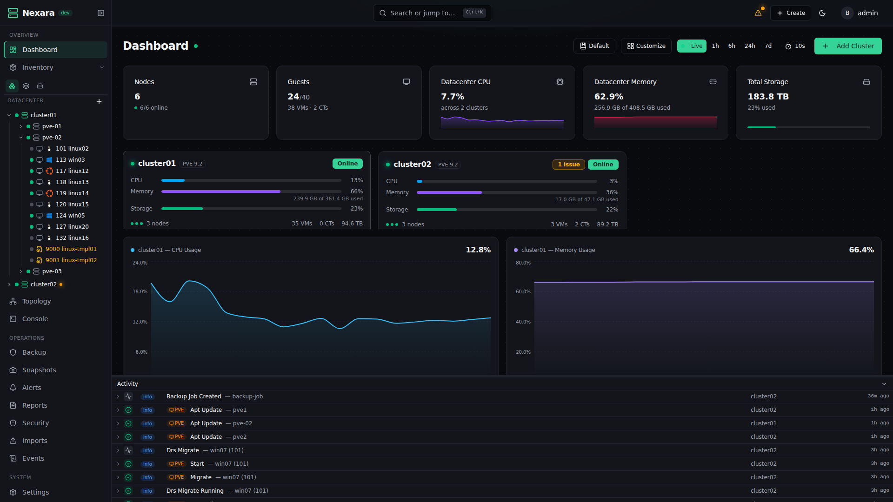
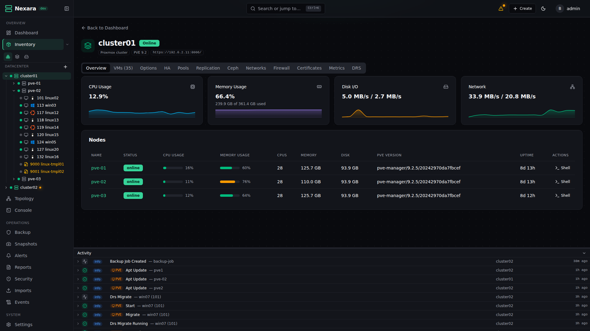
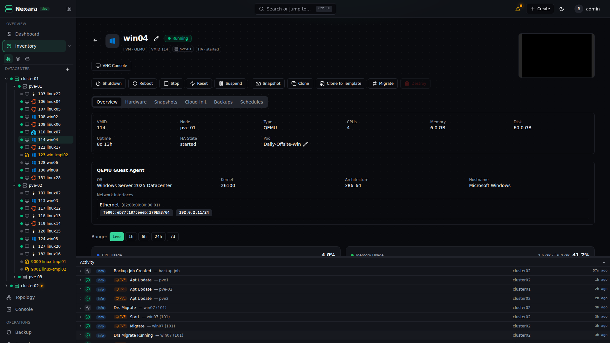
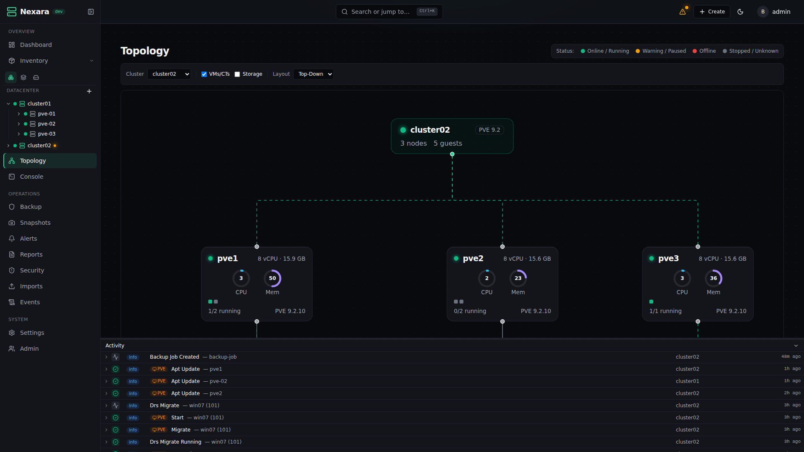
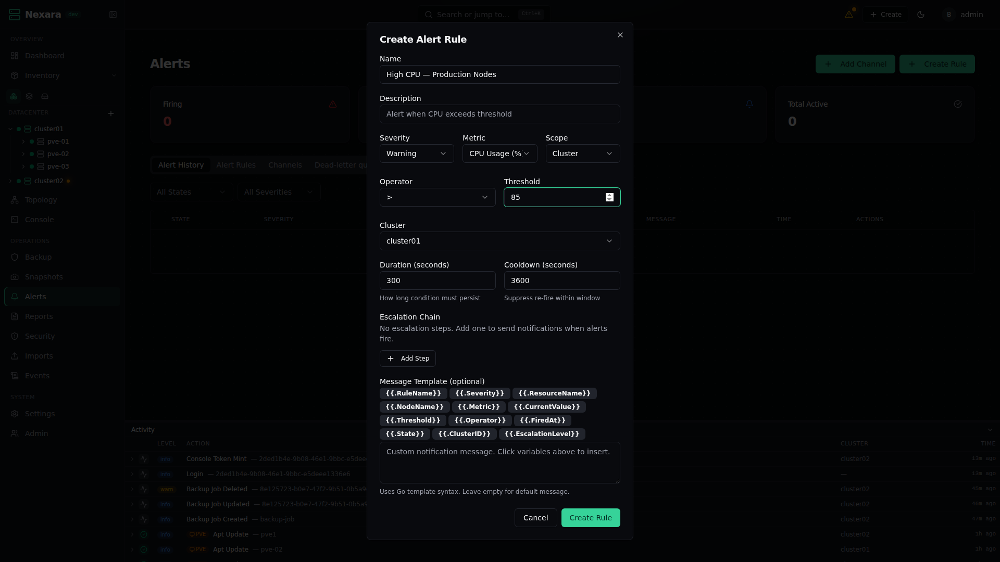
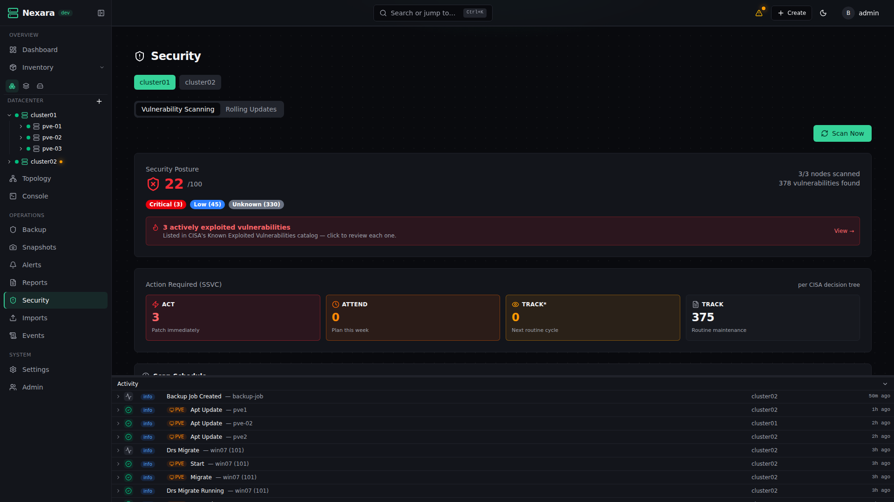
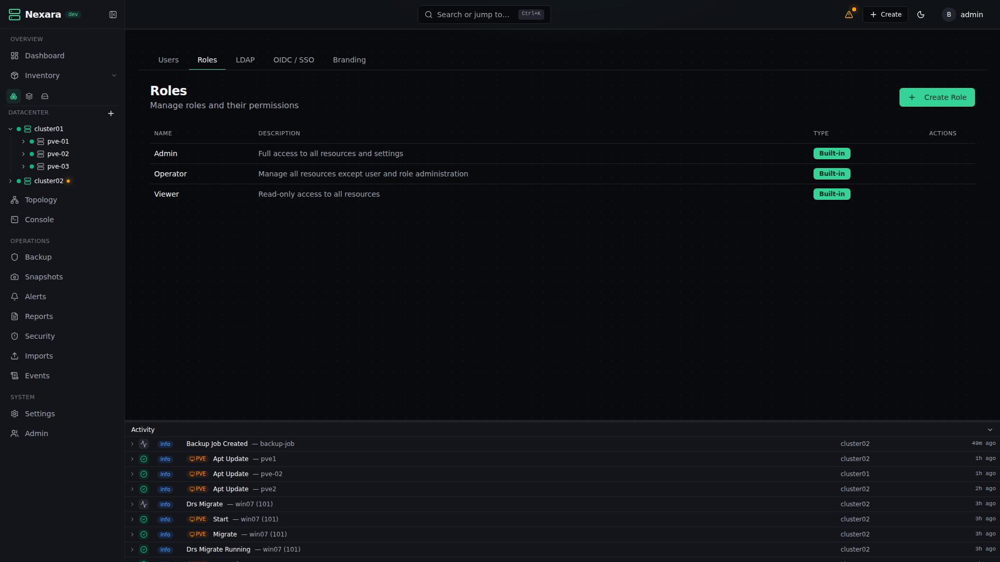
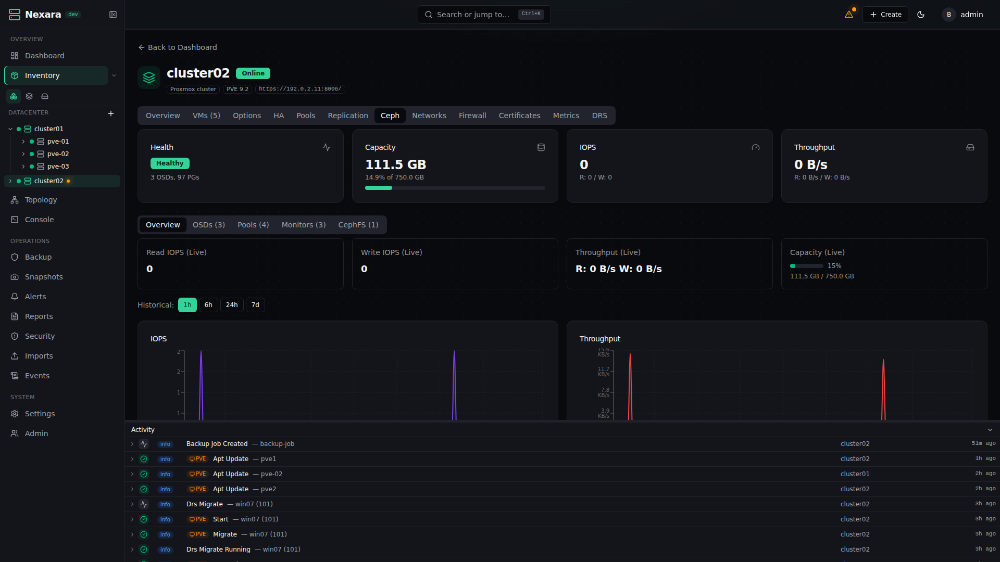
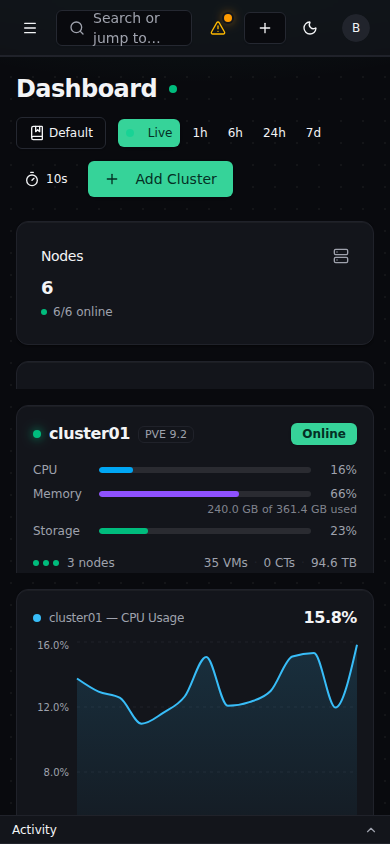
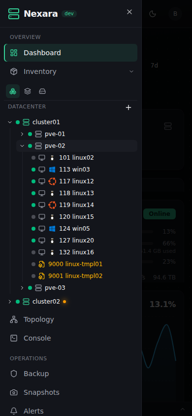

<p align="center">
  <h1 align="center">Nexara</h1>
  <p align="center">
    <strong>Centralized management for Proxmox VE & PBS — like vCenter, but open-source.</strong>
  </p>
  <p align="center">
    <a href="https://github.com/bigjakk/Nexara/stargazers"></a>
    <a href="https://github.com/bigjakk/Nexara/releases"></a>
    <a href="LICENSE"></a>
    <a href="https://ghcr.io/bigjakk/nexara"></a>
    <br>
    <a href="https://go.dev"></a>
    <a href="https://www.typescriptlang.org"></a>
    <a href="#features"></a>
    <a href="https://github.com/bigjakk/Nexara/issues"></a>
    <a href="https://github.com/bigjakk/Nexara/commits/master"></a>
  </p>
</p>

Manage multiple Proxmox clusters from a single pane of glass. Real-time dashboards, a full history of every object, granular RBAC, automated operations and enterprise security — all from one Docker Compose stack.

<p align="center">
  
</p>

<details>
<summary><strong>More screenshots</strong></summary>
<br>
<table>
  <tr>
    <td></td>
    <td></td>
  </tr>
  <tr>
    <td></td>
    <td></td>
  </tr>
  <tr>
    <td></td>
    <td></td>
  </tr>
  <tr>
    <td colspan="2"></td>
  </tr>
</table>
<p align="center"><em>Fully responsive — the whole app works on phones and tablets, not just desktop</em></p>
<p align="center">
  
  &nbsp;&nbsp;&nbsp;
  
</p>
</details>

---

## Quick Start

> **Requirements:** Docker and Docker Compose

### One-command install

```bash
curl -fsSL https://raw.githubusercontent.com/bigjakk/Nexara/master/scripts/install.sh | bash
```

### Manual setup

```bash
git clone https://github.com/bigjakk/Nexara.git && cd Nexara
cp .env.example .env        # edit POSTGRES_PASSWORD at minimum
docker compose up -d
```

Open **http://localhost** and create your admin account. That's it.

### Connecting your first cluster

**Add Cluster** → enter the API URL (`https://your-proxmox:8006`) and pick how Nexara gets its credential:

**Create a token for me (the default tab).** Supply a privileged Proxmox login once — `root@pam` and its password, plus a TOTP code if the account has 2FA. Nexara logs in, creates a dedicated `nexara@pve` user, grants it an ACL, mints a token and verifies it works. The password is used for that one request and is never stored, logged or audited; only the minted token's ciphertext is kept.

> The `pve` realm is deliberate — a PVE-realm account has no shell, no home directory and no `/etc/passwd` entry, so it cannot be used to log into a node.
>
> Over plain HTTP the UI warns before accepting a password, since it belongs to a privileged human account that is probably reused elsewhere. Pasting a token instead is no worse over HTTP than it already was.

**I have a token.** In the Proxmox web UI: **Datacenter** → **Permissions** → **API Tokens** → **Add**, create a token for an admin user (uncheck "Privilege Separation" for full access), then copy the **Token ID** (e.g. `root@pam!nexara`) and **Secret**.

Either way, Proxmox's default self-signed certificate means you'll be shown its SHA-256 fingerprint to verify and accept before the cluster is saved.

---

## Features

<table>
<tr>
<td width="50%">

### Infrastructure
- Multi-cluster management (unlimited clusters)
- Real-time CPU, memory, disk, network metrics, with 1-hour and 6-hour charts drawn sample by sample, so a one-minute stall shows instead of being averaged away
- **Pressure** — CPU, memory and IO pressure stall (PSI) charts for nodes and guests on Proxmox VE 9
- VM/CT lifecycle — create, migrate, snapshot, clone, destroy
- **VM import** — bring VMs over from ESXi/vCenter or OVA/OVF appliances (browser upload or URL)
- Disk management — resize, attach/detach, and move between storages with format conversion (raw/qcow2/vmdk) and a bandwidth limit
- Template management and resource pools
- **VM folders** — vCenter-style folder tree with a per-folder detail page (summary, guests, History, alerts)
- **Favorites** — star clusters, nodes and guests to pin them above the inventory tree
- **USB and PCI passthrough** — through Proxmox resource mappings, which Nexara builds from the node's own report of the device, so it works with an API token; a Resource Mappings tab shows Proxmox's check of each mapping on each node
- Live migration with pre-flight checks — within a cluster or across clusters, with per-disk storage placement and network mapping
- **Node evacuation** — bulk migrate a node's running guests off it
- **Health rollup** — Ceph, disk S.M.A.R.T., quorum, storage, and task failures aggregated into one dismissible health indicator
- **UPS monitoring** — the UPSes your Network UPS Tools (NUT) servers report: status, charge, runtime, load, power events and alerts; which nodes each UPS powers, with a warning for any node that has no `upsmon` to shut it down before the battery runs out; instant commands and settings through an account you give it, with the UPS's name typed for anything that cuts its power

</td>
<td width="50%">

### Node Management
- **Options and notes** — start-on-boot delay, ballooning target, Wake-on-LAN, location and notes, with a save that refuses to overwrite a change made since you opened the dialog
- **DNS & timezone** — edit directly from the UI
- **Memory modules** — every DIMM slot and the room left to grow, read with `dmidecode` over SSH
- **Temperatures** — the node's hardware sensors
- **Updates** — pending packages, and a one-node update in place without draining its guests
- **Support bundle** — download a node's `pvereport`
- **Disks** — S.M.A.R.T. data, ZFS/LVM/LVM-Thin/Directory creation with Proxmox-populated disk selectors, init GPT, wipe
- **Services** — view status, start/stop/restart node daemons
- **APT repositories** — list, enable/disable and add the standard Proxmox repositories per node
- **Firewall** — node-level rule CRUD with log viewer
- **Syslog** — real-time system log viewer with service filtering
- **Network** — create, edit, delete interfaces; apply/revert config
- **Power** — shutdown, reboot with confirmation dialogs
- **Maintenance** — per-node HA enter/exit and cluster-wide HA arm/disarm (PVE 9.2+), with maintenance indicators in the tree and node views

### Consoles
- **Floating console** — detachable, draggable iLO/iDRAC-style window with power controls, keyboard macros, screenshots, and virtual-media (ISO) mounting — or a browser tab of its own per console, with fullscreen
- **VNC** — browser-based graphical console (noVNC) for VMs, and a container's terminal
- **Node shell** — the node's login prompt, in xterm.js

### Storage & Backup
- **Storage management** — add, edit and remove datastores across 13 storage types (Directory, BTRFS, NFS, CIFS/SMB, GlusterFS, LVM, LVM-Thin, ZFS, iSCSI, iSCSI Direct, RBD, CephFS, PBS), with iSCSI target discovery instead of hand-typed IQNs
- **Content management** — ISO/template upload, download-from-URL, OCI pulls, and the Proxmox appliance browser
- PBS integration with datastore monitoring, and retention read from **prune jobs** rather than `datastore.cfg` alone
- Scheduled backups — target all guests, all-except-a-list, a resource pool, or a picked set of guests, on a schedule built from hourly/daily/weekly/monthly presets or a raw calendar string
- Restore to any cluster and node whose Proxmox has a storage set up for that PBS server
- **Snapshot inventory** — every guest snapshot across all clusters on one page, with age filters, snapshot-age alerts, and a scheduled snapshot report
- **Veeam Backup & Replication** (VBR 13.1+) — inventory collection, job and session control, per-guest protection, and orphaned-restore-point detection. Backup objects are correlated to Proxmox guests on the **SMBIOS UUID**, not the name, so a rebuilt VM is never reported as protected by a backup of the machine it replaced
- **Unified backup coverage** — one report across PBS *and* Veeam, with eligibility so Veeam's own worker appliances aren't counted as unprotected guests
- Ceph management — health, OSD, pool and CephFS monitoring; pool create/delete; OSD mark in/out and daemon start/stop/restart with a redundancy pre-flight

</td>
</tr>
<tr>
<td>

### Automation
- **DRS** — automatic workload balancing with affinity rules; coexists with Proxmox 9.2's native CRS dynamic balancer (defers automatic moves to it), and keeps off the guests Veeam owns so a worker isn't migrated mid-backup
- **Rolling updates** — drain/upgrade/reboot/restore pipeline (pauses native CRS auto-rebalance while running)
- **Alert engine** — threshold alerts, escalation chains, 7 notification channels (SMTP, Slack, Discord, Teams, Telegram, Webhook, PagerDuty)
- **CVE scanning** — each node's pending updates checked against the Debian Security Tracker on a schedule, ranked with EPSS and CISA's known-exploited list
- **Scheduled tasks** — cron-based guest snapshots and reboots
- **Windows guest tools** — track virtio-win driver and QEMU guest agent versions per guest, stage updates that apply on reboot, and pull virtio-win ISOs into Proxmox storage on a schedule you set (or from your own mirror, for air-gapped networks)

</td>
<td>

### Security & Enterprise
- **RBAC** — granular roles and permissions
- **Proxmox access control** — manage a cluster's own PVE users, API tokens, groups, roles and ACLs
- **LDAP/AD** — JIT provisioning, group-to-role mapping
- **OIDC/SSO** — Google, Okta, Keycloak, etc.
- **2FA** — TOTP with recovery codes
- **Sessions and API keys** — see and revoke your own sign-ins; API keys that act with their owner's permissions and cannot change the owner's credentials
- **Firewall** — cluster and node rules, templates, SDN

</td>
</tr>
<tr>
<td>

### History & Audit
- **History for every object** — guests, nodes, clusters, folders, storage, backup servers and jobs, UPSes and each tab of a cluster's page: what happened, who did it and how it ended, whether done in Nexara or in Proxmox
- **Edits made directly in Proxmox** — a background pass compares each cluster's guest configurations and objects with its last reading and records which fields changed, never their values
- **Task tracking** — every Proxmox task, started in Nexara or outside it, with live status, logs and an activity drawer
- **Audit log** — the full trail, exported as JSON, CSV or syslog and forwarded to a SIEM over RFC 5424

</td>
<td>

### Reports
- **Nine report types** — cluster digest, backup compliance across PBS and Veeam, resource utilisation, VM resource usage, rightsizing, capacity forecast, snapshot inventory, patch status and uptime
- **Findings first** — the things to act on, ranked in plain language, above the evidence
- Print or save as PDF, download as HTML or CSV, or schedule them to email with a digest in the body

</td>
</tr>
<tr>
<td>

### Networking
- Firewall management at cluster and node level with reusable templates, and a guest's own rules through the API
- SDN — zones, VNets, subnets, controllers, IPAM, DNS plugins
- Network interfaces — bridges, bonds, VLANs, OVS; create/edit dialogs at parity with Proxmox's own per-type options; inline edit, apply/revert
- ACME certificate management per node

</td>
<td>

### User Experience
- **Responsive design** — full functionality on phones and tablets, not just desktop
- **Installable PWA** — add Nexara to your phone's home screen as an app
- **Topology map** — interactive React Flow infrastructure view
- **Command palette** — press Ctrl+K to search and jump anywhere
- **Theming** — dark/light mode, 9 accent colors
- **Custom branding** — logo, favicon, app title
- **Localization** — i18n framework with a language selector (English ships today; translations welcome)

</td>
</tr>
</table>

---

## Architecture

Nexara runs as a **single Go binary** serving the API, WebSocket, embedded React SPA, metric collector, and task scheduler — all in one process.

```
                         ┌──────────────────────────────────────┐
   Browser ──────────▶   │        Nexara  (port 8080)           │
   (React SPA)           │                                      │
                         │   REST API    /api/v1/*              │
                         │   WebSocket   /ws/*                  │   ┌─────────────────┐
                         │   Frontend    /*  (embedded SPA)     │──▶│  PostgreSQL 16   │
                         │                                      │   │  + TimescaleDB   │
   Proxmox VE  ◀────▶   │   Collector   (goroutine)            │   └─────────────────┘
   clusters              │   Scheduler   (goroutine)            │
                         │                                      │──▶  Redis 8
                         └──────────────────────────────────────┘
```

| Container | Image | Port | Purpose |
|-----------|-------|------|---------|
| `nexara` | `ghcr.io/bigjakk/nexara` | 80 → 8080 | API + WS + SPA + collector + scheduler |
| `nexara-db` | `timescale/timescaledb:latest-pg16` | 5432 (internal) | Database with time-series |
| `nexara-redis` | `redis:8-alpine` | 6379 (internal) | Pub/sub, cache, short-lived sign-in state |

> **Running more than one replica?** Every instance serves API, WebSocket, and SPA traffic, but the collector and scheduler are each guarded by a Postgres heartbeat lease — exactly one instance runs each role at a time, and a hard-killed leader is taken over within ~40 s (a 30 s lease expiry plus the follower's 10 s retry interval). Nothing extra to configure on the Nexara side; note that the bundled `docker-compose.yml` pins `container_name` and the host port `80:8080`, so scaling out means an orchestrator (Swarm/Kubernetes) or a compose override that drops both.

---

## Configuration

All settings are environment variables. `docker-compose.yml` injects a curated subset of `.env` into the container — variables it does not name in the `nexara` service's `environment:` block must be added there, or to a `docker-compose.override.yml`, before they take effect. Secrets are auto-generated on first start and persisted as `.secrets.json` under `DATA_DIR`.

| Variable | Default | Description |
|----------|---------|-------------|
| `NEXARA_VERSION` | `latest` | Image tag to run. Pin it (e.g. `1.17.0`, no leading `v`) to choose when you upgrade. An older image will not start on a newer schema, so rolling back also needs the backup from before the upgrade |
| `POSTGRES_PASSWORD` | `changeme` | Database password (**change this**) |
| `JWT_SECRET` | auto-generated | JWT signing key |
| `ENCRYPTION_KEY` | auto-generated | AES-256-GCM key for secrets at rest |
| `API_PORT` | `8080` | Listen port *inside* the container. Compose maps host `80` → `8080`; to move the port, change the compose mapping, not this (unless you run the binary directly) |
| `METRICS_COLLECT_INTERVAL` | `30s` | How often to poll Proxmox for metrics (Docker deployments set `10s`) |
| `SNAPSHOT_SYNC_INTERVAL` | `5m` | How often the guest snapshot inventory (central Snapshots page + snapshot-age alerts) refreshes. One Proxmox call per guest per pass; floored at `60s`, `0` disables |
| `NODE_MEMORY_READ_INTERVAL` | `24h` | How often each node's memory DIMM layout is re-read with `dmidecode` over the cluster's SSH credentials (as root). Clusters without SSH credentials are never dialed; `0` disables the background read |
| `NODE_PRESSURE_SYNC_INTERVAL` | `5m` | How often each online node's pressure stall history (Proxmox VE 9) is copied from its RRD. Floored at `1m`; `0` disables it |
| `NUT_POLL_INTERVAL` | `10s` | How often each NUT server is read for its UPSes' state (Power page + UPS alerts). Floored at `2s`; `0` disables, and every UPS then reads as unreachable |
| `OBJECT_OBSERVE_INTERVAL` | `5m` | How often Nexara looks for edits made directly in Proxmox that ran no task — a guest's options, an HA resource, a firewall rule, a pool, a storage definition, a node's settings — and records the names of the fields that changed in the object's History. One Proxmox call per guest per pass, at most ten a second per cluster. Held between `1m` and `1h`; `0` disables it |
| `LOG_LEVEL` | `info` | `debug` / `info` / `warn` / `error` |
| `PUID` / `PGID` | `1000` | Container user/group ID |
| `DATA_DIR` | Docker volume | Custom data path (e.g. NFS mount) |
| `TRUSTED_PROXIES` | empty | Comma-separated IPs/CIDRs whose `X-Forwarded-For` is trusted. **Set this when behind a reverse proxy** so rate limiters key on the real client IP. |
| `PROXY_HEADER` | `X-Forwarded-For` | Header consulted for the client IP when the remote is on `TRUSTED_PROXIES`. |
| `WS_ALLOWED_ORIGINS` | empty (allow all) | Comma-separated exact origins allowed to open WebSocket connections. **Set to your public origin in production** (CSRF defence). |
| `SECURE_COOKIES` | `auto` | `auto` / `always` / `never` — `Secure` flag on the refresh-token cookie. `auto` infers HTTPS from `X-Forwarded-Proto`, but only from a `TRUSTED_PROXIES` upstream. **Set `always`** when TLS terminates at a reverse proxy. |
| `HSTS_MAX_AGE` | `0` (off) | Seconds for `Strict-Transport-Security`. Enable only on HTTPS with a trusted certificate — over a self-signed origin it pins HTTPS and makes cert errors unbypassable. Otherwise emit HSTS at the proxy. |
| `COMPRESSION_ENABLED` | `true` | gzip/brotli on API and SPA responses (`/api/v1/api-docs` drops ~710 KB → ~81 KB). Set `false` only when a reverse proxy already compresses, to save the duplicated CPU. |

See [`.env.example`](.env.example) and the [Installation Guide](docs/installation.md#configuration-reference) for the full reference.

---

## Reverse Proxy

Nexara serves everything on a single port, so proxy config is simple:

<details>
<summary><strong>Nginx</strong></summary>

```nginx
server {
    listen 443 ssl;
    server_name nexara.example.com;

    client_max_body_size 15G;      # your largest ISO upload; Nexara sets no limit of its own
    proxy_request_buffering off;   # stream large uploads straight through

    location / {
        proxy_pass http://127.0.0.1:80;
        proxy_set_header Host $host;
        proxy_set_header X-Real-IP $remote_addr;
        proxy_set_header X-Forwarded-For $proxy_add_x_forwarded_for;
        proxy_set_header X-Forwarded-Proto $scheme;

        # WebSocket support
        proxy_set_header Upgrade $http_upgrade;
        proxy_set_header Connection "upgrade";
        proxy_read_timeout 86400s;
    }
}
```
</details>

<details>
<summary><strong>Traefik</strong></summary>

```yaml
# docker-compose.override.yml
services:
  nexara:
    labels:
      - "traefik.enable=true"
      - "traefik.http.routers.nexara.rule=Host(`nexara.example.com`)"
      - "traefik.http.routers.nexara.tls.certresolver=letsencrypt"
      - "traefik.http.services.nexara.loadbalancer.server.port=8080"
```
</details>

<details>
<summary><strong>Caddy</strong></summary>

```
nexara.example.com {
    reverse_proxy nexara:8080
}
```
</details>

> **Tips:** Set proxy max body size as large as your biggest ISO upload (Nexara streams uploads and sets no limit of its own), and disable request buffering so the proxy streams them instead of spooling them to its own disk first. Ensure WebSocket `Upgrade` headers are forwarded. Use long read timeouts for persistent WebSocket connections. Nexara closes a kept-alive connection after 3 minutes without a request, so if you raise the proxy's idle timeout for its connections to Nexara, keep it under that — the nginx, Traefik and Caddy defaults (60 s, 90 s, 2 min) all are.

> **Set `TRUSTED_PROXIES`** to your reverse proxy's IP/CIDR (e.g. `127.0.0.1` or `10.0.0.0/8`). Without it, every request appears to come from the proxy and the per-IP auth/refresh/general rate limiters protect the *cluster*, not the *attacker*. If the proxy uses a non-standard header, also set `PROXY_HEADER`.

> **Do not strip or redirect trailing slashes under `/api/`.** Nexara refuses a `POST`, `PUT`, `PATCH` or `DELETE` whose path ends in `/`, because that is what a browser sends when it resolves a path segment named `.` or `..` away: a `DELETE` meant for a pool named `..` arrives as `DELETE /api/v1/clusters/<id>/`. A proxy that removes the slash turns that refused request back into the parent's `DELETE`, and so does one that answers with a redirect to the slash-less path. Browsers repeat the request at the new URL, with its `Authorization` header when the redirect stays on the same origin: a 307 or 308 keeps every method, and a 301 or 302 keeps every method but `POST`, the only one they turn into a `GET` — so a `DELETE`, `PUT` or `PATCH` follows any of the four. Pass the path on as the client sent it, too. nginx's `proxy_pass` without a URI part does, provided nothing such as a `rewrite` has changed the URI first; with a URI part (even a bare `/`), or after such a change, nginx forwards its decoded, normalised copy of the path, in which a `%2F` inside a name is a path separator again. A configuration that has to rewrite can forward the original URI explicitly, as `proxy_pass http://127.0.0.1:80$request_uri;` — nginx passes a URI built from variables as it is, and `$request_uri` is the one the client sent. Caddy's `reverse_proxy` forwards the path as sent unless a rewrite is configured.

> **Behind Traefik.** Traefik resolves `.` and `..` segments itself before it routes a request — its `sanitizePath` entry-point option, on by default — after decoding `%2E` to `.`, and a final dot segment loses its slash on the way: `DELETE /api/v1/clusters/<id>/pools/..` from a script or other non-browser client, spelled raw or as `%2E%2E`, reaches Nexara as `DELETE /api/v1/clusters/<id>`, with no slash left to refuse. (Measured by replaying Traefik v3.7.13's own path-handling code on those requests.) Nexara refuses it anyway: a cluster delete must carry `confirm` set to the cluster's name, which a request rewritten from another route never does. A browser's request meets the trailing-slash refusal above, because the browser resolves the segment itself and keeps the slash, which Traefik leaves in place. Nexara does not rely on that sanitising. With `sanitizePath` off, Traefik still decodes `%2E` but forwards the dot segment unresolved — its proxy joins the path as a string — and Nexara routes the path as it arrives, so the same request reaches the pool route, whose rule refuses a pool id of `.` or `..` with a 400. An entry point that serves only Nexara can therefore turn it off (`entryPoints.<name>.http.sanitizePath=false`); one it shares with other services should keep whatever they need. Whatever the proxy, an API client must never send `.` or `..` as a path segment, and percent-encoding it does not help.

> **TLS terminated at the proxy?** Nexara only sees plain HTTP, so set `SECURE_COOKIES=always` — the `auto` default only infers HTTPS from `X-Forwarded-Proto` on a `TRUSTED_PROXIES` upstream, and warns at startup when it can't. Set `WS_ALLOWED_ORIGINS=https://nexara.example.com` (exact scheme + host + port) to lock WebSocket upgrades to your own origin. Leave `HSTS_MAX_AGE` at `0` and emit HSTS from the proxy instead. Note that `SECURE_COOKIES` and `HSTS_MAX_AGE` are not in `docker-compose.yml`'s `environment:` block — add them to the `nexara` service (or a `docker-compose.override.yml`) for them to take effect.

---

## Tech Stack

| Layer | Technology |
|-------|-----------|
| Backend | Go 1.27, Fiber v3, sqlc + pgx, gorilla/websocket |
| Frontend | React 19, TypeScript 6, Vite 8, Tailwind CSS v4, Shadcn/ui, TanStack Query/Table, Zustand, Recharts, xterm.js, noVNC, React Flow |
| Database | PostgreSQL 16 + TimescaleDB |
| Cache | Redis 8 (Valkey compatible) |
| Deploy | Docker Compose (3 containers) |

---

## Documentation

| | |
|--|--|
| [Installation Guide](docs/installation.md) | Setup, configuration, updating, backup and restore, troubleshooting |
| [Admin Guide](docs/admin-guide.md) | Clusters, guests, consoles, migration, storage, backup, networking, UPS monitoring, RBAC and auth, alerts, DRS, HA, rolling updates, History, reports |
| [API Reference](docs/api-reference.md) | Auth, errors, rate limits, WebSocket protocol and every endpoint group. A running install also has a live catalog: **API Keys** in the user menu, then **View API Documentation** |
| [Contributing](docs/contributing.md) | Dev environment, project layout, adding an endpoint, testing, PR process |

---

## License

[GNU Affero General Public License v3.0](LICENSE)

---

## Trademarks

Proxmox and Proxmox Backup Server are registered trademarks of Proxmox Server
Solutions GmbH. Veeam and Veeam Backup & Replication are registered trademarks
of Veeam Software Group GmbH. VMware and ESXi are registered trademarks of
Broadcom Inc.

Nexara is an independent project and is not affiliated with, sponsored by, or
endorsed by any of them. Those names are used solely to identify the software
Nexara interoperates with. No vendor logo or brand asset is distributed with
this project — the in-app provider marks and colours are Nexara's own.
